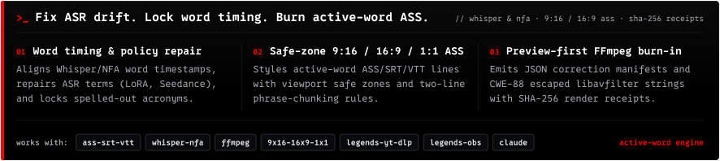
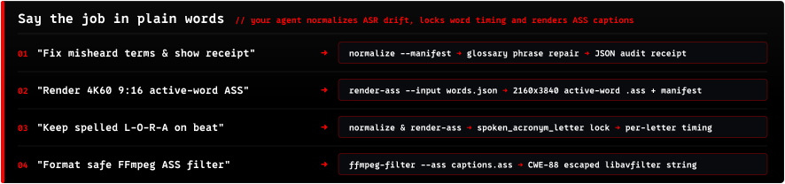
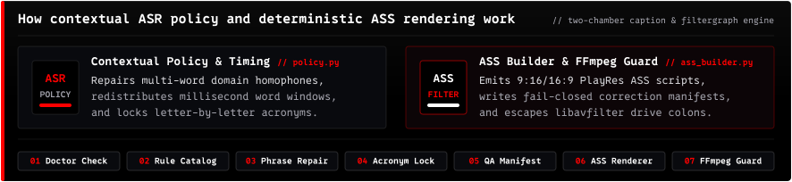
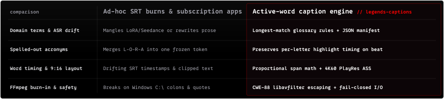

# 

[](https://github.com/avalonreset/legends-captions/releases/latest)
[](https://github.com/avalonreset/legends-captions/actions/workflows/tests.yml)
[](https://github.com/avalonreset/legends-captions/actions/workflows/contract.yml)
[](pyproject.toml)
[](src/legends_captions/cli.py)
[](LICENSE)

**Active-word video caption, Whisper/NFA word-timestamp alignment, ASS/SRT/VTT styling, and FFmpeg burn-in CLI engine (`legends-captions`) for coding agents: repair misheard domain terms (`LoRA`, `Seedance`), preserve letter-by-letter spoken acronym timing (`L O R A`), render safe-zone 9:16 / 16:9 / 1:1 SubStation Alpha scripts with JSON audit receipts, and format CWE-88 escaped FFmpeg `libavfilter` strings.**


```text
Install or update legends-captions via cto-legends (https://github.com/avalonreset/cto-legends): run `cto-legends install legends-captions --apply`, then `cto-legends handoff legends-captions` and follow the returned JSON recipe to verify `legends-captions`.
```



## Why `legends-captions` exists

Raw speech-to-text subtitles and ad-hoc chat cleanup routinely break production video workflows:

1. **Mangled domain terms and stiff chat rewrites:** Raw ASR transcribes `LoRA` as `low raw` or `Seedance 2.0` as `C dance 2.0`, while pasting a subtitle file into a free-form chat window often rewrites your natural speaking voice, drops lines, and forgets your custom glossary on the very next video.
2. **Broken word timestamps and frozen spelled-out acronyms:** When a two-word misheard phrase is repaired into a four-word technical term, naive text replacements corrupt subtitle timecodes. Worse, generic cleanup collapses spoken letters like `L O R A` into a single token, freezing active-word highlight animations across four spoken syllables.
3. **Unescaped FFmpeg `libavfilter` paths on Windows and macOS:** Passing a raw Windows path (`C:\work\captions.ass`) or a filename containing quotes, brackets, or semicolons into `ffmpeg -filter_complex "ass=filename=..."` fails on drive colons or opens argument-injection risks (`CWE-88`).

`legends-captions` is a deterministic, zero-dependency Python CLI engine that treats contextual ASR phrase repair, proportional word-span redistribution, spoken acronym letter locking, SubStation Alpha (`.ass`) rendering, and FFmpeg `libavfilter` escaping as one auditable release pipeline.

## Ask in plain english

Once [`cto-legends`](https://github.com/avalonreset/cto-legends) is installed, you ask your coding agent in plain english. It inspects the active glossary, normalizes ASR drift, redistributes word timestamps, writes `.ass` scripts and JSON audit manifests, and formats safe FFmpeg burn-in filtergraphs:



## Architecture: contextual policy engine and deterministic ASS builder



### 1. Contextual ASR policy, proportional word timing, and spoken acronym lock (`policy.py`)

Before a single subtitle event is rendered, `apply_caption_policy` runs a deterministic two-pass pipeline over inline text or word-timed JSON (`tokens`, `words`, `events`, or `segments` from faster-whisper or NVIDIA NeMo Parakeet / NeMo Forced Aligner):

- **Longest-match domain glossary and grammar repair:** Repairs high-evidence ASR errors (`low raw` to `LoRA`, `C dance 2.0` / `exacting 2.0` to `Seedance 2.0`, `what is this unlock` to `what does this unlock`, `sticking the 30` to `sticking to 30`) while preserving trailing punctuation and surrounding prose.
- **Proportional millisecond timing redistribution (`distribute_timing`):** Whenever a phrase rule changes token count, the original audio time span (`first.start` to `last.end`) is subdivided evenly across the replacement tokens so active-word highlights never jump, overlap, or freeze.
- **Letter-by-letter spoken acronym lock (`mark_spoken_acronyms`):** Detects runs of single spoken letters matching known technical acronyms (`api`, `css`, `gpu`, `html`, `lora`, `nfa`, `seo`, `ui`, `ux`, `vram`) and tags each letter with `spoken_acronym_letter` so word-by-word captions highlight every syllable on beat.

| Heard by ASR | Display policy | Rule category |
| :--- | :--- | :--- |
| `low raw` / `low ra` / `low-ra` | `LoRA` | `domain_term` |
| `C dance 2.0` / `sea dance 2.0` | `Seedance 2.0` | `contextual_model_name` |
| `exacting 2.0` in AI-video context | `exciting as Seedance 2.0` | `contextual_model_name` |
| `what is this unlock` | `what does this unlock` | `grammar_repair` |
| `sticking the 30` | `sticking to 30` | `idiom_repair` |
| `L O R A` | `L O R A` (per-letter highlight lock) | `spoken_acronym_timing` |

### 2. Safe-zone ASS renderer, JSON audit manifests, and CWE-88 FFmpeg guard (`ass_builder.py` & `cli.py`)

Every subcommand in `legends-captions` is hardened against injection, non-finite timestamps, and accidental file overwrites:

| Command | Surface | What It Does |
| :--- | :--- | :--- |
| `legends-captions doctor` | **Readiness & Profile Check** | Verifies Python 3.11+, active style profile (`configs/default_vertical_4k60.json`), checkout state, and optional `ffmpeg` / `ffprobe` binaries on `PATH`. |
| `legends-captions policy-report` | **Correction Rule Catalog** | Prints the full JSON catalog of active phrase rules, replacement strings, categories, confidence scores, and rationales. |
| `legends-captions normalize` | **Text Repair & QA Manifest** | Normalizes inline text (`--uppercase`) or emits a structured `legends_captions.policy_manifest.v1` JSON audit receipt (`--manifest`) recording every decision and token span. |
| `legends-captions render-ass` | **9:16 / 16:9 / 1:1 ASS Builder** | Emits active-word (`--mode word`) or full-line (`--mode line`) `.ass` subtitle documents for any PlayRes canvas (`--width 2160 --height 3840` default) with atomic fail-closed writes (`--overwrite` required to replace existing files) and optional `--manifest-output`. |
| `legends-captions ffmpeg-filter` | **CWE-88 FFmpeg Filter Guard** | Escapes Windows drive colons, backslashes, quotes, brackets, commas, and semicolons into a deterministic `[0:v]setpts=PTS-STARTPTS,ass=filename='...'[v]` filtergraph string (`--json` supported). |

## Ad-hoc SRT burns vs `legends-captions`



## Quick start

```sh
# 1. Verify runtime health, active 4K60 profile, and FFmpeg availability
legends-captions doctor
legends-captions policy-report

# 2. Preview contextual ASR phrase normalization and spoken acronym locking
legends-captions normalize --uppercase "low raw teaches the model"
legends-captions normalize --uppercase "it may not be as exacting 2.0,"
legends-captions normalize --manifest "L O R A."

# 3. Render active-word 4K60 vertical (2160x3840) or 16:9 (3840x2160) ASS subtitles
legends-captions render-ass --uppercase "low raw teaches the model"
legends-captions render-ass --input words.json --output captions.ass --manifest-output correction_manifest.json --uppercase --overwrite

# 4. Format an injection-safe FFmpeg libavfilter string for burn-in
legends-captions ffmpeg-filter --ass captions.ass --json
```

## Reference

<details>
<summary><strong>Upstream transcript and video handoffs (<code>legends-yt-dlp</code>, <code>legends-obs</code>, <code>legends-youtube</code>)</strong></summary>

`legends-captions` corrects, times, and renders captions without bundling heavy ASR model weights or recording audio itself. Pair it with sibling modules in the `cto-legends` ecosystem:

- [`legends-yt-dlp`](https://github.com/avalonreset/legends-yt-dlp) to pull source videos, extract audio, and generate local GPU word-timestamp JSON ledgers.
- [`legends-ambient-intelligence`](https://github.com/avalonreset/legends-ambient-intelligence) for recorded voice memos and offline Whisper or Parakeet transcription.
- [`legends-hyperyap`](https://github.com/avalonreset/legends-hyperyap) for live local voice dictation.
- [`legends-obs`](https://github.com/avalonreset/legends-obs) to capture verified local 4K60 tutorial and creator recordings.
- [`legends-youtube`](https://github.com/avalonreset/legends-youtube) to upload final captioned videos or attach subtitle tracks to draft uploads.

Read [docs/AGENT-RECIPE.md](docs/AGENT-RECIPE.md), [docs/architecture.md](docs/architecture.md), [Caption Intelligence Policy](wiki/policies/Caption%20Intelligence%20Policy.md), and [Revision Learning Policy](wiki/policies/Revision%20Learning%20Policy.md) for full QA and revision rules.

</details>

<details>
<summary><strong>Agent setup (via <code>cto-legends</code>) and standalone installation</strong></summary>

### Agent setup (via `cto-legends`)

Part of [cto-legends](https://github.com/avalonreset/cto-legends). The central router skill is vendored at [skills/cto-legends/SKILL.md](skills/cto-legends/SKILL.md); this module is not a separate registered skill and does not require an ambient MCP daemon.

Run `cto-legends handoff legends-captions` and read the returned installed recipe and task-readiness checks. If the module is missing, preview setup with `cto-legends install legends-captions`, perform the authorized setup, then repeat the handoff. Use `cto-legends check-updates` to compare your installed version with the catalog and published release. See [docs/AGENT-RECIPE.md](docs/AGENT-RECIPE.md) and [docs/install/agent-install-guide.md](docs/install/agent-install-guide.md) for the standalone recipe.

```sh
python -m venv .venv
python -m pip install -e .
legends-captions doctor
```

</details>

<details>
<summary><strong>Repository layout, verification, and FAQ</strong></summary>

```text
configs/    reusable caption style (default_vertical_4k60.json) and correction glossary
docs/       agent recipe, install guide, architecture, compatibility, and release checklist
skills/     pinned copy of the central cto-legends router skill (only registered skill)
src/        zero-dependency Python package (policy, ass_builder, manifest, cli)
tests/      regression tests covering CLI smoke, symlink/CWE-88 guards, and phrase policy
wiki/       policies, playbooks, and QA checklists for active-word caption deployment
```

```sh
python -m pytest -v
python -m unittest discover -s tests
python scripts/check_release.py
```

**Does `legends-captions` bundle FFmpeg or ASR model weights?**
No. It is a deterministic, zero-dependency caption policy, normalization, and `.ass` subtitle / manifest engine (`doctor`, `policy-report`, `normalize`, `render-ass`, `ffmpeg-filter`) that works alongside external tools (`ffmpeg`, `faster-whisper`, or NVIDIA NeMo Parakeet/NFA) on your machine without bundling model weights or spawning hidden shell wrappers.

**Can I generate subtitles without burning them into a new video file?**
Yes. `legends-captions render-ass` emits standalone styled `.ass` subtitle documents and JSON policy-correction manifests (`--manifest-output`), and `legends-captions ffmpeg-filter --ass <path>` formats a safely escaped `libavfilter` `ass=filename='...'` filtergraph string for when you choose to run an FFmpeg burn-in pass.

</details>

## Contributing, security, and license

See [CONTRIBUTING.md](CONTRIBUTING.md), [SUPPORT.md](SUPPORT.md), and [SECURITY.md](SECURITY.md).

MIT License. See [LICENSE](LICENSE) and [THIRD_PARTY_NOTICES.md](THIRD_PARTY_NOTICES.md). Copyright (c) 2026 Avalon Reset.

[](https://github.com/avalonreset/cto-legends/issues/new?title=Message%20for%20Avalon%20Reset&labels=message)

<p align="center"><a href="https://github.com/stars/avalonreset/lists/cto-legends"></a></p>

**Specification & benchmarks on cto-legends.com:**
- **Module specification & architecture matrix:** [cto-legends.com/modules/legends-captions](https://cto-legends.com/modules/legends-captions)
- **Related engineering dispatches:** [How to Build AI Agents: Production CLI & MCP Routing](https://cto-legends.com/blog?post=how-to-build-ai-agents-cli-mcp-routing) · [Browser Automation AI: Computer Use Agent Benchmarks](https://cto-legends.com/blog?post=browser-automation-ai-computer-use-benchmarks) · [Claude Code Skills: MCP vs CLI Workflow Architecture](https://cto-legends.com/blog?post=claude-code-skills-mcp-vs-cli-workflow)
- **Ecosystem hub:** [cto-legends.com/home](https://cto-legends.com/home)
